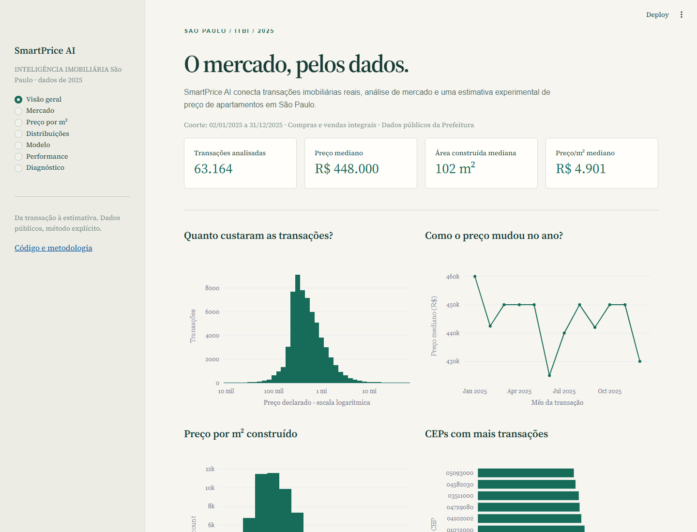
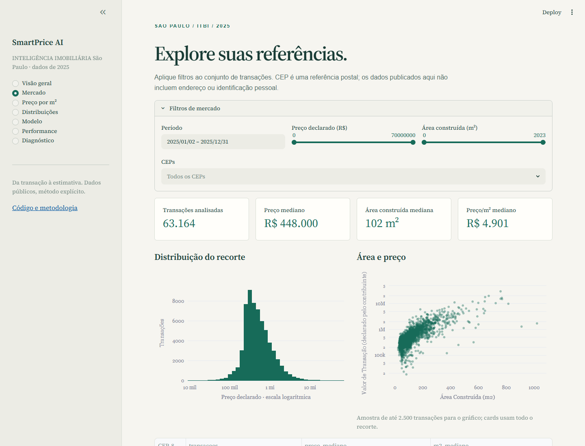
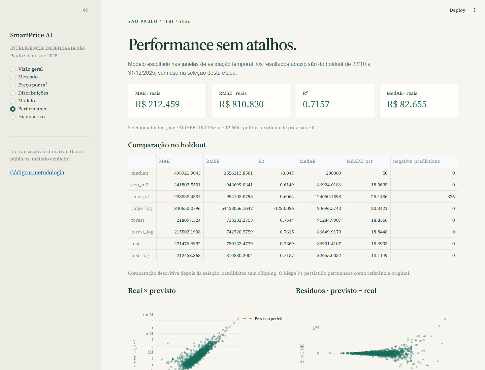

# SmartPrice AI

Análise de transações de apartamentos e estimativa experimental de preços em São Paulo com dados públicos de ITBI, validação temporal e dashboard Streamlit.

[Código](https://github.com/TenorioDevfullStack/smartprice-ai) · [Notebook de modelagem](notebooks/02_modelagem.ipynb) · [Métricas completas](models/metrics.json) · [Guia de deploy](docs/deploy.md)



## Visão geral

O projeto parte de declarações reais, preserva a exploração anterior e entrega um fluxo reproduzível: dados → processamento → features → baselines → candidatos → validação temporal → seleção → holdout → pipeline persistido → aplicação.

## Problema

Como criar uma referência de preço com atributos cadastrais limitados e avaliar seus erros sem misturar passado e futuro? O objetivo é demonstrar uma metodologia auditável, incluindo falhas em imóveis de alto valor e categorias inéditas.

## Dataset

Fonte: [Dados das Transações Imobiliárias com recolhimento de ITBI, Prefeitura de São Paulo](https://prefeitura.sp.gov.br/web/fazenda/w/acesso_a_informacao/31501). Arquivo local original: `GUIAS DE ITBI PAGAS (28012026) XLS.xlsx`, preservado. A publicação mensal acompanha o recolhimento do imposto e pode conter transações de outros períodos; a coorte usa a **data da transação**.

O conjunto V3 possui **63,164 registros** entre **02/01/2025 e 31/12/2025**, de compras e vendas integrais de apartamentos, com valor declarado ≥ R$ 10 mil e área positiva. Sem valores ausentes nas quatro features, preço e data. Há 7.533 CEPs distintos.

O arquivo `data/processed/smartprice_demo.csv.gz` contém a coorte completa com quatro features, preço, data e índice técnico. Mede 797 KiB; o dashboard não lê o XLSX de 46,7 MB. Não exportamos endereço, número, complemento, SQL ou informações de financiamento nos novos artefatos.

**Área construída cadastral não é necessariamente área útil.** O valor declarado para ITBI também pode divergir de um valor de mercado. O CSV público é uma projeção das declarações, sem enriquecimento com dados pessoais.

## Pipeline de dados

1. Consolidar as 12 planilhas de 2025 na ordem original.
2. Filtrar uso de apartamento, compra e venda, proporção transmitida de 100%, área e preço positivos.
3. Manter preço ≥ R$ 10 mil e data da transação em 2025.
4. Remover cópias exatamente iguais em todas as colunas V2, incluindo `Mes_Arquivo` (48 cópias).
5. Normalizar CEP para texto com oito dígitos; validar schema, finitude e ACC cadastral.
6. Congelar as mesmas observações e índices das partições recuperadas; verificar SHA-256 e round-trip.

Existem 750 coincidências na projeção reduzida. Elas **não foram removidas**, pois não comprovam transações duplicadas. O critério histórico não deduplica operações semelhantes entre planilhas mensais. `python -m src.verify_raw` reconstrói a V3 sem executar o notebook e compara todos os índices, atributos, preços e datas às partições recuperadas.

## EDA

O dashboard explora preço, área construída, preço/m², CEPs mais frequentes e medianas mensais. A mediana de preço é R$ 448 mil, a área mediana é 102 m² e a mediana do preço/m² é aproximadamente R$ 4.901. Não são medidas de valorização de um imóvel constante: composição das transações varia por mês.

## Feature engineering

Entradas brutas: `Área Construída (m2)`, `CEP_8`, `Padrão (IPTU)` e `ACC (IPTU)` (ano cadastral de construção).

- Ridge usa as quatro features V1: escala numérica e CEP completo em one-hot com categorias raras agrupadas (`min_frequency=5`, `infrequent_if_exist`); padrão aceita categorias novas com `ignore`.
- Árvores recebem área, `log1p(área)`, ACC, prefixo postal de três dígitos e padrão IPTU. RF usa one-hot; HGB usa categorias nativas via ordinal encoder com código -1 para desconhecidos. Não atribuímos nomes de bairros aos prefixos.
- Data define splits e gráficos; não é entrada da estimativa. Não acrescentamos dormitórios, vagas, bairro ou região inexistentes na projeção aprovada.
- Preço/m² e variáveis monetárias fiscais ou de financiamento são excluídos dos modelos ML. A comparação de log mantém a mesma representação dentro de cada família; diferenças entre famílias incluem suas representações.

## Baselines

**Ridge V1 preservado:** alpha=1, solver=lsqr. As previsões persistidas foram reproduzidas exatamente e seus artefatos anteriores mantidos por hash.

Baselines adicionais: mediana global do preço e mediana de preço/m² por CEP × área, calculadas somente no treino. CEPs com menos de cinco exemplos ou inéditos usam a mediana global de preço/m² do treino. A baseline por CEP é metodologicamente separada do uso de preço/m² como input ML.

## Machine Learning

Oito candidatos: mediana global, baseline por CEP, Ridge original/log, RandomForest original/log e HistGradientBoosting original/log. RF: 100 árvores, profundidade máxima 16, folha mínima 5. HGB: 180 iterações, learning rate 0,08, 31 folhas, folha mínima 30, early stopping desativado para evitar validação aleatória interna. Seeds e parâmetros ficam no código.

`log1p(y)` é invertido com `expm1` antes das métricas. Não há correção lognormal de viés, e não se promete que target em log sempre melhore. O Ridge log mostrou instabilidade entre janelas. Nenhuma biblioteca de boosting externa foi adicionada.

## Validação temporal

| Janela | Treino expansivo | n treino | Validação | n validação |
|---|---|---:|---|---:|
| 1 | 2025-01-02 a 2025-05-31 | 25447 | 2025-06-01 a 2025-07-31 | 10600 |
| 2 | 2025-01-02 a 2025-07-31 | 36047 | 2025-08-01 a 2025-08-31 | 5367 |
| 3 | 2025-01-02 a 2025-08-31 | 41414 | 2025-09-01 a 2025-10-21 | 9184 |

Seleção por MAE ponderado nas 25.151 previsões fora da amostra dessas três janelas; estabilidade e diagnósticos são reportados. O vencedor foi **hist_log**. A vantagem sobre o Ridge aparece nas três janelas; a diferença para as melhores árvores é pequena, sem afirmação de superioridade estatística.

| Modelo | MAE validação ponderado (R$) | Desvio entre janelas (R$) |
|---|---:|---:|
| hist_log | 193.496,89 | 4.266,15 |
| forest | 194.383,28 | 1.521,29 |
| forest_log | 195.700,41 | 2.377,80 |
| hist | 196.961,34 | 4.271,64 |
| cep_m2 | 234.181,61 | 5.717,93 |
| ridge_v1 | 279.928,42 | 9.562,30 |
| ridge_log | 337.584,43 | 48.817,15 |
| median | 461.851,78 | 11.083,67 |

Após a seleção registrada, o escolhido foi reajustado em **50.598 registros, 02/01–21/10/2025**. O holdout contém **12.566 registros, 22/10–31/12/2025**. Não usamos split aleatório como avaliação principal. A publicação dos resultados de todos os candidatos no holdout é descritiva; a escolha não muda com eles.

**Limitação histórica:** o holdout do Ridge já havia sido examinado no diagnóstico anterior. A etapa atual não usa esses resultados na seleção, mas não representa um teste prospectivo completamente cego.

## Resultados

Métricas calculadas em reais, no holdout completo. Candidatos abaixo sem clipping:

| Modelo | MAE (R$) | RMSE (R$) | R² | MedAE (R$) | Negativas |
|---|---:|---:|---:|---:|---:|
| median | 498.921,90 | 1.556.113,86 | -0,0470 | 200.000,00 | 0 |
| cep_m2 | 241.802,55 | 943.699,03 | 0,6149 | 86.924,02 | 0 |
| ridge_v1 | 288.838,43 | 954.108,08 | 0,6064 | 124.050,79 | 326 |
| ridge_log | 840.653,08 | 54.433.056,16 | -1.280,0860 | 94.696,57 | 0 |
| forest | 218.097,52 | 738.232,28 | 0,7644 | 91.284,99 | 0 |
| forest_log | 215.502,19 | 742.720,58 | 0,7615 | 86.649,92 | 0 |
| hist | 221.476,70 | 780.133,48 | 0,7369 | 86.901,41 | 0 |
| hist_log | 212.458,86 | 810.830,20 | 0,7157 | 82.655,00 | 0 |

O modelo final possui MAE **R$ 212.458,86**, RMSE **R$ 810.830,20**, R² **0,7157**, MedAE **R$ 82.655,00** e MdAPE **18,11%**. A redução descritiva de MAE frente ao Ridge V1 é 26,44% neste holdout; não é garantia de desempenho futuro.

## Diagnóstico

| Faixa real | n | MAE (R$) | MedAE (R$) | Erro médio (R$) | Subestimação | Superestimação |
|---|---:|---:|---:|---:|---:|---:|
| Até R$ 500 mil | 7144 | 88.068,39 | 52.004,92 | 39.302,44 | 44,92% | 55,08% |
| R$ 500 mil–1 mi | 3105 | 162.520,83 | 121.584,89 | -13.673,81 | 63,80% | 36,20% |
| R$ 1–2 mi | 1563 | 338.581,34 | 273.552,20 | -106.870,32 | 70,44% | 29,56% |
| R$ 2–5 mi | 613 | 808.265,35 | 637.129,72 | -289.846,45 | 69,66% | 30,34% |
| Acima de R$ 5 mi | 141 | 3.626.248,59 | 2.124.778,15 | -2.544.096,60 | 71,63% | 28,37% |

Na cauda acima de R$ 5 milhões: **141 casos**, MAE **R$ 3.626.248,59**, erro médio **R$ -2.544.096,60** e **71,63% de subestimação**. Ridge V1: 91,49% de subestimação nessa cauda. A fragilidade persiste.

Ridge original: **326 previsões negativas**. Escolhido antes/depois da política física: **0/0**. O pipeline final aplica limite explícito ≥ 0; os diagnósticos dos candidatos mantêm suas previsões sem esse limite. Há **413 CEPs inéditos em 532 registros** e nenhum padrão IPTU inédito no holdout.

Faixa demonstrativa: percentil 80 do erro absoluto em validação, agrupado pelo preço **previsto**; grupos com menos de 50 casos usam erro global. Rotulada “faixa baseada no erro histórico do modelo”. Não é intervalo de confiança nem garantia. Cobertura observada no holdout: **78,74%**. Seleção e calibração compartilham validação, o que pode produzir otimismo.

## Limitações

- Uma cidade, apartamentos e compras e vendas integrais; sem validação para casas, terrenos ou outras cidades.
- Coorte de 2025; não há inflação, atualização de mercado ou validação em 2026.
- Valor declarado, área cadastral, amostragem administrativa e possível repetição de operações entre meses.
- Sem dormitórios, vagas, conservação, atributos de condomínio, coordenadas ou comparação de imóveis idênticos.
- Amostra pequena e erros grandes na cauda superior; relações descritivas não são causais.
- O agrupamento postal das árvores perde parte da resolução do CEP completo.
- Validação temporal não impede que imóveis/empreendimentos semelhantes apareçam em janelas diferentes; não há split por imóvel identificado.

**Modelo experimental baseado em transações de ITBI de São Paulo. Não substitui avaliação imobiliária profissional.**

## Dashboard

Sete páginas: Visão geral, Mercado, Preço por m², Distribuições, Modelo, Performance e Diagnóstico. Filtros de período, preço, área e CEP; formulário das quatro features; mensagens para entradas inválidas, CEPs inéditos e extrapolação. Métricas completas; gráficos de resíduos e real × previsto usam amostra determinística de até 2.500 casos.





## Como executar

Python **3.13**, na raiz do repositório:

```bash
python -m venv .venv
# Linux/macOS: source .venv/bin/activate
# Windows PowerShell: .venv\Scripts\Activate.ps1
python -m pip install -r requirements.txt
python -m pytest -q
python -m src.train
python -m streamlit run app/dashboard.py
```

Os artefatos compactos já estão incluídos, então o dashboard pode iniciar sem retreinar ou executar notebook. O treino reproduz as comparações a partir da V3 congelada; não altera o Ridge V1. Num checkout existente com `.venv` antigo, crie outro ambiente em vez de sobrescrevê-lo.

```bash
# Verificar a fonte bruta e os artefatos anteriores (opcional)
python -m src.verify_raw
python src/diagnosticar_baseline_v1.py --inspect
# Exploração, notebook e screenshots (opcional)
python -m pip install -r requirements-dev.txt
python scripts/document_results.py
python scripts/execute_modeling_notebook.py
python scripts/capture_dashboard.py
```

A captura espera Streamlit em `127.0.0.1:8501` e Chrome instalado. Dependências de notebook/gráficos históricos ficam em requirements-dev, não no startup do app. Arquivos joblib são carregados apenas de artefatos confiáveis deste repositório.

## Deploy

Preparado para Streamlit Community Cloud: branch `main`, arquivo **`app/dashboard.py`**, Python **3.13** escolhido em Advanced settings e dependências pinadas em `requirements.txt`. [Instruções oficiais](https://docs.streamlit.io/deploy/streamlit-community-cloud/deploy-your-app/deploy).

Sem `.env`, segredos, API externa ou caminhos Windows no runtime. Modelo final ~277 KiB; CSV ~797 KiB. [Checklist e limites de verificação](docs/deploy.md). Preparação e testes locais não significam que uma aplicação pública já foi publicada.

## Estrutura do projeto

```text
app/                 dashboard Streamlit e helpers
src/                 contratos, features, modelos, avaliação, treino, inferência
data/raw/            XLSX original preservado
data/processed/      V3 compacta e partições/previsões V1 preservadas
models/              Ridge V1, modelo final e métricas
reports/             qualidade, seleção e diagnóstico agregado
notebooks/           01 original + 02 modelagem
tests/               contratos, inferência, persistência e AppTest
docs/screenshots/    capturas reais desktop e mobile
scripts/             documentação e verificação visual
.streamlit/          tema e configuração
```

## Próximos passos

Validação prospectiva em nova coorte; deduplicação baseada em identidade de imóvel com cuidado de privacidade; atributos físicos adicionais legítimos; calibração separada da seleção; comparar diferentes níveis de agrupamento geográfico e estabilidade por segmento. Só adotar mudanças depois de validá-las temporalmente.

## Autor

[TenorioDevfullStack](https://github.com/TenorioDevfullStack). Projeto de portfólio em Data Science e Machine Learning. A autoria é identificada pelo perfil do repositório; não inferimos nome civil ou credenciais.
