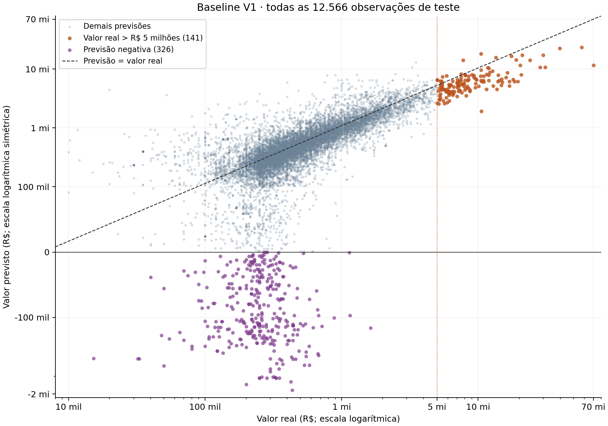
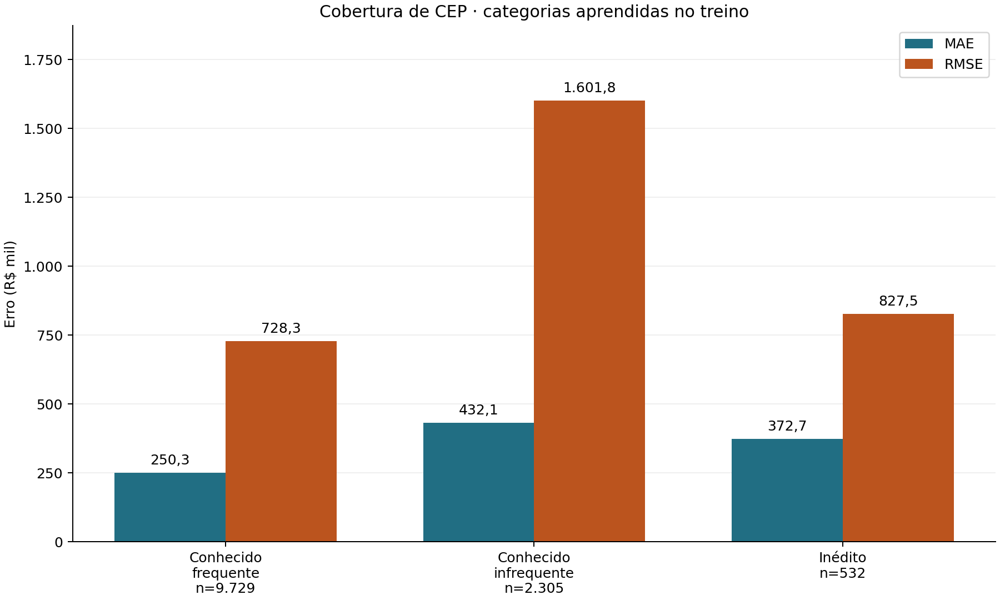

# RESULTADO DA ETAPA — DIAGNÓSTICO BASELINE V1

**Data:** 16/10/2026 · SmartPrice AI. Diagnóstico executado exclusivamente sobre os quatro artefatos recuperados; sem treinamento, ajuste, remoção de observações ou implementação de V2.

## Validação e metodologia

Os quatro caminhos foram confirmados antes do carregamento:

- `U:\smartprice-ai\models\baseline_v1_recuperado.joblib`
- `U:\smartprice-ai\data\processed\baseline_v1_particoes.joblib`
- `U:\smartprice-ai\data\processed\baseline_v1_previsoes_teste.csv`
- `U:\smartprice-ai\models\baseline_v1_manifesto.json`

**Validação: OK.** Os três hashes de arquivos disponíveis no manifesto conferem. As seis assinaturas de partição conferem em contagem, colunas, conteúdo e índice ordenado. X, y e datas têm índices únicos e alinhados; treino e teste são disjuntos. CSV lido com `float_precision='round_trip'`, índice e datas preservados. Targets e datas coincidem exatamente com as partições. `pipeline.predict(X_test)` reproduz bit a bit as previsões salvas. Todos os parâmetros do pipeline conferem com o manifesto e as cinco métricas globais foram reproduzidas.

Treino: **50.598 registros**, 02/01/2025–21/10/2025. Teste: **12.566 registros**, 22/10/2025–31/12/2025. A análise usa uma cópia de X_test; as seis partições mantêm suas assinaturas ao final. Pipeline: Ridge `alpha=1.0`, `solver='lsqr'`.

Erro assinado = **previsto − real**: viés negativo indica subestimação. MAE é a média de |erro| e não a mediana. RMSE é a raiz da média dos erros quadráticos; R² compara com a média do valor real **dentro de cada grupo**, portanto não mede sozinho o efeito da cobertura. A mediana percentual usa |previsto − real| / real. Grupos são descritivos, sem testes de significância ou controle de fatores. Nenhum valor foi truncado.

Limite de proveniência: o manifesto não possui hash de si próprio; seu SHA-256 foi registrado antes/depois desta etapa. Os hashes históricos de fontes brutas e células são referências da recuperação e não foram usados como dados nem revalidados nesta análise. Não havia hashes históricos das partições anteriores à recuperação para comparação independente. A validação atual se refere aos artefatos recuperados.

| Grupo | n | MAE (R$) | RMSE (R$) | R² | Viés médio (R$) | Viés mediano (R$) | Mediana |erro| (R$) | Mediana |erro|/real |
| --- | --- | --- | --- | --- | --- | --- | --- | --- |
| Teste completo | 12.566 | 288.838,43 | 954.108,08 | 0,6064 | -9.513,37 | -7.978,30 | 124.050,79 | 25,15% |

## 1. Imóveis com valor real acima de R$ 5 milhões

**141 imóveis (1,12% do teste)**. 129 subestimados (91,49%); nenhum com previsão negativa. Concentram **16,81% da soma dos erros absolutos** e **73,98% da soma dos erros quadráticos** do teste.

| Grupo | n | MAE (R$) | RMSE (R$) | R² | Viés médio (R$) | Viés mediano (R$) | Mediana |erro| (R$) | Mediana |erro|/real |
| --- | --- | --- | --- | --- | --- | --- | --- | --- |
| Real > R$ 5 milhões | 141 | 4.328.012,76 | 7.747.262,97 | 0,1794 | -3.964.119,02 | -2.271.821,95 | 2.370.760,51 | 33,12% |
| Real ≤ R$ 5 milhões | 12.425 | 243.001,53 | 489.427,65 | 0,4486 | 35.363,85 | -5.927,45 | 121.812,20 | 24,98% |

Valor real entre R$ 5.009.238,93 e R$ 70.000.000,00; mediana R$ 7.700.000,00. Área mediana **509 m²**, contra 100 m² nos demais imóveis; intervalo de 273–2.023 m². ACC mediano 2.015, contra 2.010 nos demais. Não foram atribuídos significados adicionais aos códigos de padrão IPTU.

### Características associadas aos erros de alto valor

| Grupo | n | MAE (R$) | RMSE (R$) | R² | Viés médio (R$) | Viés mediano (R$) | Mediana |erro| (R$) | Mediana |erro|/real |
| --- | --- | --- | --- | --- | --- | --- | --- | --- |
| >200–500 m² | 66 | 3.099.522,28 | 4.026.147,84 | -0,7292 | -3.041.927,78 | -2.433.541,33 | 2.433.541,33 | 38,63% |
| >500 m² | 75 | 5.409.084,38 | 9.928.397,38 | 0,1566 | -4.775.647,31 | -2.160.939,53 | 2.235.144,58 | 28,27% |

Acima de 500 m², o MAE em reais é maior, mas a mediana percentual é menor que no grupo de 200–500 m². Dentro dos 141 imóveis, Spearman entre área e erro assinado = **-0,048** e entre área e |erro| = **0,138**: não há associação monotônica forte que permita atribuir a subestimação apenas à área.

| Grupo | n | MAE (R$) | RMSE (R$) | R² | Viés médio (R$) | Viés mediano (R$) | Mediana |erro| (R$) | Mediana |erro|/real |
| --- | --- | --- | --- | --- | --- | --- | --- | --- |
| 22 | 1 | 2.300.046,39 | 2.300.046,39 | indefinido | -2.300.046,39 | -2.300.046,39 | 2.300.046,39 | 35,39% |
| 23 | 18 | 2.582.221,39 | 3.123.636,52 | -2,0100 | -2.415.405,28 | -2.366.800,16 | 2.366.800,16 | 35,44% |
| 24 | 77 | 3.336.427,89 | 4.576.548,16 | -0,3351 | -3.326.057,15 | -2.223.464,60 | 2.223.464,60 | 35,21% |
| 25 | 45 | 6.768.107,12 | 12.173.892,47 | 0,1121 | -5.712.378,67 | -2.849.512,78 | 3.470.970,50 | 28,36% |

O padrão 25 tem o maior MAE dentre os grupos com várias observações; 24 concentra a maior quantidade de casos. O padrão 22 tem apenas um caso: sem generalização.

| Grupo | n | MAE (R$) | RMSE (R$) | R² | Viés médio (R$) | Viés mediano (R$) | Mediana |erro| (R$) | Mediana |erro|/real |
| --- | --- | --- | --- | --- | --- | --- | --- | --- |
| Conhecido frequente | 98 | 3.668.113,18 | 5.834.681,54 | 0,3835 | -3.344.587,73 | -2.209.437,16 | 2.229.304,59 | 29,57% |
| Conhecido infrequente | 37 | 6.314.066,20 | 11.667.941,26 | -0,0520 | -6.238.516,02 | -3.010.104,49 | 3.010.104,49 | 44,62% |
| Inédito | 6 | 2.859.042,92 | 3.859.109,55 | -4,9133 | -57.682,00 | -988.250,09 | 2.093.821,52 | 32,92% |

Os conhecidos infrequentes apresentam maior MAE neste segmento; os seis inéditos são insuficientes para inferência estável. Os grupos diferem em preço, área e padrão; a tabela não isola o efeito do CEP.

| Grupo | n | MAE (R$) | RMSE (R$) | R² | Viés médio (R$) | Viés mediano (R$) | Mediana |erro| (R$) | Mediana |erro|/real |
| --- | --- | --- | --- | --- | --- | --- | --- | --- |
| ACC até 1980 | 20 | 2.995.365,85 | 3.684.331,98 | -1,2505 | -2.995.365,85 | -2.203.369,86 | 2.203.369,86 | 34,82% |
| ACC 1981–2000 | 20 | 2.430.469,73 | 3.469.736,22 | -0,3341 | -1.894.490,99 | -1.132.915,46 | 1.629.450,72 | 25,18% |
| ACC 2001–2020 | 47 | 5.481.155,56 | 11.275.257,89 | 0,1773 | -4.760.088,47 | -2.183.567,32 | 2.300.046,39 | 30,87% |
| ACC após 2020 | 54 | 4.520.718,07 | 6.048.242,23 | 0,1506 | -4.396.657,17 | -3.043.197,99 | 3.043.197,99 | 38,97% |

ACC é apresentado com seus valores originais, agrupados em faixas para evitar conclusões a partir de anos com pouquíssimas observações. Essas comparações não estabelecem causalidade.

## 2. Previsões negativas

**326 previsões negativas (2,59% do teste)**, confirmando a quantidade anteriormente reportada. Todas subestimam valores reais positivos. MAE **R$ 452.982,16**, viés médio **−R$ 452.982,16**, viés mediano **−R$ 364.041,04**; RMSE R$ 544.565,43.

| Característica | Previsões negativas | Demais previsões |
| --- | --- | --- |
| Valor real mediano (R$) | 250.000,00 | 450.000,00 |
| Área mediana (m²) | 49 | 102 |
| ACC mediano | 1.974 | 2.010 |

Previsões entre **−R$ 1.717.321,08** e **−R$ 435,50**; mediana −R$ 95.638,51. Valores reais entre R$ 15.286,00 e R$ 1.630.000,00. Área de 7 a 265 m²; 50% entre 40 e 60 m².

| Grupo | Registros no teste | Previsões negativas | Taxa no grupo |
| --- | --- | --- | --- |
| Até 50 m² | 1.710 | 175 | 10,23% |
| >50–100 m² | 4.550 | 122 | 2,68% |
| >100–200 m² | 4.472 | 26 | 0,58% |
| >200–500 m² | 1.670 | 3 | 0,18% |
| >500 m² | 164 | 0 | 0,00% |

**297 de 326 (91,10%)** têm até 100 m². A taxa por faixa confirma a concentração em áreas pequenas; contagem e taxa têm denominadores distintos.

| Grupo | Registros no teste | Previsões negativas | Taxa no grupo |
| --- | --- | --- | --- |
| 11 | 1 | 0 | 0,00% |
| 12 | 2 | 0 | 0,00% |
| 14 | 1 | 0 | 0,00% |
| 20 | 98 | 1 | 1,02% |
| 21 | 836 | 59 | 7,06% |
| 22 | 9.112 | 251 | 2,75% |
| 23 | 2.020 | 15 | 0,74% |
| 24 | 418 | 0 | 0,00% |
| 25 | 78 | 0 | 0,00% |

O padrão 22 concentra **251/326 (76,99%)** negativos, mas também domina o teste. A taxa do padrão 21 (**59/836; 7,06%**) supera a do 22 (**251/9.112; 2,75%**); a concentração absoluta em 22 não equivale à maior taxa de ocorrência. Não há padrões inéditos no teste.

| Grupo | Registros no teste | Previsões negativas | Taxa no grupo |
| --- | --- | --- | --- |
| ACC até 1980 | 2.043 | 197 | 9,64% |
| ACC 1981–2000 | 2.679 | 35 | 1,31% |
| ACC 2001–2020 | 4.656 | 42 | 0,90% |
| ACC após 2020 | 3.188 | 52 | 1,63% |

**197/326 (60,43%)** negativos têm ACC até 1980, contra **1.846/12.240 (15,08%)** nas demais previsões. Esta associação descritiva não separa área, localização e padrão.

| Grupo | Registros no teste | Previsões negativas | Taxa no grupo |
| --- | --- | --- | --- |
| Conhecido | 12.034 | 304 | 2,53% |
| Inédito | 532 | 22 | 4,14% |

| Grupo | Registros no teste | Previsões negativas | Taxa no grupo |
| --- | --- | --- | --- |
| Conhecido frequente | 9.729 | 227 | 2,33% |
| Conhecido infrequente | 2.305 | 77 | 3,34% |
| Inédito | 532 | 22 | 4,14% |

Os negativos envolvem **213 CEPs distintos**; **304/326** são de CEPs conhecidos e **227/326** de conhecidos frequentes. Portanto, eles também ocorrem amplamente em categorias aprendidas no treino.

| CEP | Negativos | Registros do CEP no teste | Taxa |
| --- | --- | --- | --- |
| 05021000 | 9 | 15 | 60,00% |
| 03336010 | 9 | 10 | 90,00% |
| 08260030 | 6 | 13 | 46,15% |
| 01217010 | 5 | 13 | 38,46% |
| 01233001 | 5 | 14 | 35,71% |
| 05716090 | 4 | 5 | 80,00% |
| 03210001 | 4 | 13 | 30,77% |
| 02611001 | 4 | 9 | 44,44% |
| 04194260 | 4 | 19 | 21,05% |
| 01232000 | 4 | 7 | 57,14% |

CEPs acima ordenados pela contagem de negativos (dez primeiros); amostras pequenas e seleção pelo resultado impedem tratar suas taxas como estimativas estáveis.

### Conferência algébrica do pipeline ajustado

A saída de `preprocessamento.transform(X_test)` foi multiplicada pelos coeficientes Ridge já aprendidos. Intercepto e blocos reproduzem as previsões com diferença máxima **R$ 0,00000000**. Nenhum ajuste foi feito.

| Componente médio da previsão (R$) | Negativos | Demais previsões |
| --- | --- | --- |
| Intercepto | 980.455,93 | 980.455,93 |
| Área padronizada × coeficiente | -573.568,22 | 36.744,16 |
| ACC padronizado × coeficiente | -90.194,69 | 4.024,33 |
| Bloco CEP | -278.116,72 | -10.194,50 |
| Bloco padrão IPTU | -212.519,18 | -215.790,81 |
| Soma = previsão média | -173.942,88 | 795.239,11 |

No grupo negativo, as contribuições médias dos blocos somam um valor abaixo de zero com o intercepto. A Ridge em reais não impõe restrição de positividade. A decomposição explica a conta deste pipeline, sem interpretar coeficientes como efeitos causais; seus valores dependem da codificação e da centralização utilizadas.

## 3. Cobertura de CEPs entre treino e teste

| Medida | Quantidade |
| --- | --- |
| CEPs distintos no treino | 7.120 |
| CEPs distintos no teste | 4.480 |
| CEPs distintos presentes em ambos | 4.067 |
| CEPs distintos inéditos no teste | 413 |
| Registros com CEP inédito | 532 (4,23% do teste) |
| CEPs ausentes: registros treino / teste | 0 / 0 |

Comparação literal de CEP_8 preservando os tipos originais. Nenhuma normalização adicional, imputação manual ou recomposição da divisão foi feita.

## 4. Desempenho por cobertura de CEP

| Grupo | n | MAE (R$) | RMSE (R$) | R² | Viés médio (R$) | Viés mediano (R$) | Mediana |erro| (R$) | Mediana |erro|/real |
| --- | --- | --- | --- | --- | --- | --- | --- | --- |
| Conhecido | 12.034 | 285.130,55 | 959.321,34 | 0,6110 | -14.294,83 | -8.416,35 | 122.465,60 | 24,63% |
| Inédito | 532 | 372.711,89 | 827.454,01 | 0,3809 | 98.644,85 | -3.023,23 | 161.540,08 | 39,97% |

Nos inéditos, o MAE é **30,72% maior**; a mediana percentual passa de 24,63% para 39,97%. O RMSE dos conhecidos é maior, apesar do MAE menor: ele dá mais peso aos extremos e os grupos têm composições diferentes.

### Conferência da composição por valor real

Entre os conhecidos há **135** imóveis acima de R$ 5 milhões; entre os inéditos, **6**. A comparação abaixo é um estrato descritivo do mesmo teste, **sem excluir registros da base nem da avaliação global**:

| Grupo | n | MAE (R$) | RMSE (R$) | R² | Viés médio (R$) | Viés mediano (R$) | Mediana |erro| (R$) | Mediana |erro|/real |
| --- | --- | --- | --- | --- | --- | --- | --- | --- |
| Conhecido | 11.899 | 238.521,35 | 476.472,58 | 0,4756 | 32.487,66 | -6.007,75 | 120.347,56 | 24,47% |
| Inédito | 526 | 344.350,70 | 722.918,51 | -0,1246 | 100.428,05 | -3.023,23 | 160.428,67 | 39,97% |

No estrato de até R$ 5 milhões, o RMSE dos inéditos supera o dos conhecidos. Isso mostra que a ordenação pelo RMSE agregado não é suficiente para avaliar cobertura. A estratificação não controla todas as diferenças de perfil.

### Separação entre conhecidos frequentes e infrequentes

| Grupo | n | MAE (R$) | RMSE (R$) | R² | Viés médio (R$) | Viés mediano (R$) | Mediana |erro| (R$) | Mediana |erro|/real |
| --- | --- | --- | --- | --- | --- | --- | --- | --- |
| Conhecido frequente | 9.729 | 250.321,04 | 728.322,24 | 0,7162 | -4.048,12 | -9.721,18 | 109.382,42 | 21,71% |
| Conhecido infrequente | 2.305 | 432.055,38 | 1.601.799,33 | 0,4244 | -57.544,42 | 6.423,71 | 194.990,23 | 41,71% |
| Inédito | 532 | 372.711,89 | 827.454,01 | 0,3809 | 98.644,85 | -3.023,23 | 161.540,08 | 39,97% |

Os conhecidos infrequentes têm MAE e RMSE maiores que os conhecidos frequentes. Isso sustenta avaliar representações espaciais que compartilhem informação entre CEPs, sem demonstrar que a codificação seja a única responsável.

## 5. OneHotEncoder: comportamento verificado

O encoder ajustado usa `min_frequency=5` e `handle_unknown='infrequent_if_exist'`. Aprendeu **7.120 categorias de CEP**, das quais **3.996 CEPs distintos** tiveram menos de cinco registros no treino. Esses CEPs correspondem a **8.336 registros de treino**. São 3.124 categorias frequentes mais uma coluna compartilhada: **3.125 colunas de saída**.

O bucket infrequente existe. A transformação foi conferida para **todos** os registros: os **532 inéditos** e os **2.305 conhecidos infrequentes** ativam a **mesma coluna** `infrequent_sklearn`, com soma de linha igual a 1 no bloco CEP. Assim, **2.837 registros de teste (22,58%)** compartilham essa representação espacial. Os inéditos não recebem um bloco todo zerado neste pipeline.

Esta conclusão foi conferida no encoder já ajustado, sem construir ou ajustar outro encoder. Padrão IPTU usa `handle_unknown='ignore'`, mas há **zero categorias inéditas de padrão** no teste, inclusive entre os negativos. Logo, bloco de padrão zerado por categoria desconhecida não explica esses casos.

## 6. Gráficos

Figura 1: todos os registros do teste, sem amostragem, corte de outliers ou truncamento. X logarítmico; Y logarítmico simétrico, linear entre −R$ 100 mil e R$ 100 mil para preservar zero e negativos. A linha tracejada indica previsão perfeita; a vertical marca R$ 5 milhões.

Figura 2: erros em R$ mil, com n por grupo. Métricas calculadas sobre todos os registros de cada grupo; diferenças de perfil permanecem.

## 7. Principais conclusões

1. Há subestimação concentrada no segmento de alto valor: 129/141 casos; o viés mediano é −R$ 2,27 milhões. Sua participação nos erros quadráticos (73,98%) mostra por que o RMSE global é sensível a esse segmento. Isso não autoriza eliminar extremos.

2. As 326 previsões negativas se concentram em áreas menores e ACCs mais baixos; a decomposição confirma como os termos do modelo ajustado compõem valores negativos. A maioria ocorre em CEPs conhecidos, inclusive frequentes, e nenhum padrão IPTU é inédito.

3. Cobertura espacial importa para a avaliação: inéditos têm MAE e erro percentual mediano maiores; conhecidos infrequentes também têm pior desempenho que frequentes. Comparações observacionais e R² de grupos distintos não demonstram efeito causal do CEP.

## 8. Até três recomendações para o futuro Modelo V2

1. **Avaliar uma formulação com saída positiva**, por exemplo target logarítmico com inversão adequada. Motivação: 326/12.566 previsões negativas e erro percentual mediano de 136,81% nesses casos. Comparar erros em reais e percentuais, viés e desempenho no alto valor; a inversão pode introduzir viés e comprimir o topo. Não adotar truncamento como correção deste diagnóstico.

2. **Avaliar não linearidades e interações de área, ACC, padrão e localização.** Motivação: subestimação em 91,49% dos imóveis de alto valor, MAE elevado no padrão 25 e perfis distintos dos negativos. Isso é hipótese a testar; a correlação fraca entre área e erro no alto valor não sustenta uma explicação por área isolada.

3. **Avaliar representação hierárquica de CEP**, com prefixos e compartilhamento de informação entre raros/inéditos. Motivação: 413 CEPs inéditos e 2.837 registros de teste no mesmo bucket; MAE de R$ 432.055,38 nos conhecidos infrequentes contra R$ 250.321,04 nos frequentes. Comparar cobertura e métricas por grupo, com quaisquer estatísticas aprendidas somente no treino e sem vazamento do target.

Estas são propostas para experimentos futuros. A escolha de V2 exigirá validação temporal no treino ou nova janela de confirmação: este teste já foi inspecionado. Nenhuma das recomendações foi implementada ou teve ganho demonstrado nesta etapa.

## 9. Integridade e reprodução

**Os quatro artefatos originais permaneceram intactos:** SHA-256 antes/depois idêntico, inclusive para o manifesto. Nenhum fit, ajuste, reconstrução de bases ou execução de células foi realizado. As bases, a divisão temporal, os índices, o Ridge e os outliers foram preservados. O notebook também não foi editado. Somente este diretório, o script de análise e o plano desta etapa foram acrescentados.

| Arquivo | SHA-256 antes = depois |
| --- | --- |
| models/baseline_v1_recuperado.joblib | `6cd765e9f90c11cb6cc2d4642325af872523d61141a9f511c497c9a58055dcb6` |
| data/processed/baseline_v1_particoes.joblib | `23b11bf70d7646dd90307a4caf347804f873c0f7083be54f5c6d0bdc3cc4e345` |
| data/processed/baseline_v1_previsoes_teste.csv | `ad8a20d4e4fe10f567fb943526ed9b95a1b0e2d4ca025a6d18a25be98e0d5be2` |
| models/baseline_v1_manifesto.json | `82bce1259ffbea9dc78382ab10fdaad1ff16db47e8dc03b8669a09fe856c1109` |

Versões efetivas: pandas 3.0.3; numpy 2.4.1; scikit-learn 1.8.0; scipy 1.17.1; joblib 1.5.3; matplotlib 3.10.9. Correspondem às versões destas bibliotecas no manifesto de recuperação. A .venv original aponta para um executável ausente; foi usado o Python 3.13.5 disponível, sem instalar dependências.

Comando executado, a partir da raiz: `python src/diagnosticar_baseline_v1.py`. O script valida tudo antes da análise e verifica novamente os artefatos ao final. Para reproduzir os cálculos com a entrega já existente: `python src/diagnosticar_baseline_v1.py --inspect`, que somente imprime os cálculos. Os arquivos desta entrega são criados exclusivamente em diretório novo para impedir sobrescrita acidental. O JSON contém métricas agregadas e evidências de validação, sem exportar microdados.

Verificação adicional: `python -m unittest discover -s tests -v` (2 testes). O teste de proteção invoca o script de recuperação, que recusa os artefatos existentes antes de qualquer treinamento; nenhuma célula é executada.

**Etapa encerrada.** Nenhum Modelo V2 foi treinado ou implementado.
